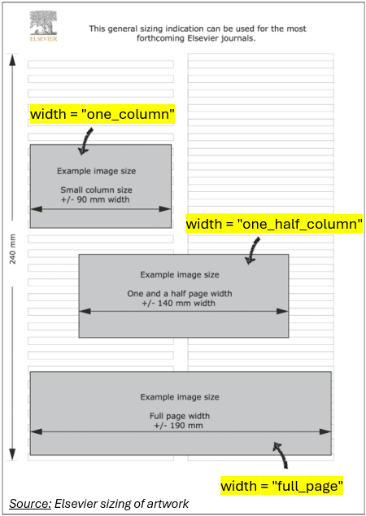

When preparing figures for a scientific manuscript, getting the plot right is only half the work. We also need to export it at an appropriate size for journal submission.

I created [`ggsave_elsevier()`](https://le-huynh.github.io/lehuynh/reference/ggsave_elsevier.html), a small wrapper around `ggplot2::ggsave()` in my R package [**lehuynh**](https://le-huynh.github.io/lehuynh/) to make this step easier. 
Pick a column width by name, give a height, and the figure is saved at journal-ready size.

## Why `ggsave_elsevier()`?

Elsevier's [artwork sizing guidelines](https://www.elsevier.com/about/policies-and-standards/author/artwork-and-media-instructions/artwork-sizing) provide recommended artwork widths for different figure layouts:

| `width =`            | Layout                  | Width  |
|----------------------|-------------------------|--------|
| `"one_column"`       | Single column           | 90 mm  |
| `"one_half_column"`  | 1.5 column              | 140 mm |
| `"full_page"`        | Double column (full width) | 190 mm |

Height is up to us, in millimetres, with a maximum of 240 mm.



## Installation

```{r}
#| eval: false
# install.packages("remotes")
remotes::install_github("le-huynh/lehuynh")
```

## Usage

```r
ggsave_elsevier(filename, 
                plot,
                width = c("one_column", "one_half_column", "full_page"),
                height,
                ...)
```

```{r}
#| eval: false
library(ggplot2)
library(lehuynh)

fig <- ggplot(mtcars, aes(x = disp, y = mpg)) +
  geom_point(aes(colour = factor(cyl)))

ggsave_elsevier("figure1.png",
                plot = fig,
                width  = "full_page",
                height = 120)
```

That's it: `figure1.png` is 190 mm wide and 120 mm tall.

Anything that passes through `...` goes straight to `ggplot2::ggsave()`, so we keep full control over resolution, file format, and device, e.g. `dpi = 300` or a `.tiff` / `.pdf` filename.

## Why bother with a wrapper?

- **No more magic numbers.** `width = "one_column"` reads better in a script than `width = 90, units = "mm"`, and it documents intent.
- **Design at final size.** Saving at the real print width early means font sizes, point sizes, and legends get tuned for how the figure will actually appear in the journal, not how it looks in RStudio's plot pane.
- **Consistency across a manuscript.**

## Give it a try

- Function documentation: [`ggsave_elsevier()`](https://le-huynh.github.io/lehuynh/reference/ggsave_elsevier.html)
- Source code and issues: [github.com/le-huynh/lehuynh](https://github.com/le-huynh/lehuynh)

Give it a try! If you run into any issues or have ideas for similar helpers, feel free to open an [issue](https://github.com/le-huynh/lehuynh/issues) on GitHub. I'd love to hear about it!

---

[← Back to all blog posts](../../blog.qmd)
