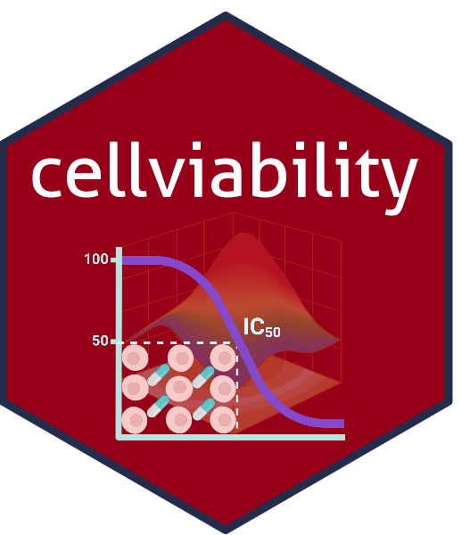

<a href="https://yen-kim.github.io/cellviability/" target="_blank">

</a>  

<a href="https://lifecycle.r-lib.org/articles/stages.html#stable" target="_blank">

</a>  

<a href="https://doi.org/10.5281/zenodo.21820265" target="_blank">

</a>  

<br>

→ <a href="https://github.com/yen-kim/cellviability" target="_blank">GitHub repository</a>  


`cellviability` is designed to facilitate the analysis of cell-based drug screening experiments. The package provides functions for fitting dose-response models, estimating IC50 values, visualizing regression curves, comparing treatment groups, and evaluating drug synergy using commonly used pharmacological models.  


> Nguyen, Y. T.-K., **Le-Huynh, T.-L.**, & Theilgaard-Monch, K. (2026). cellviability (Version v0.1.3) [Computer software]. Zenodo. [https://doi.org/10.5281/zenodo.21820265](https://doi.org/10.5281/zenodo.21820265){target=_blank}

<hr>

### Installation

To get the latest in-development features, install the development
version from GitHub:

```r
if (!requireNamespace("devtools", quietly = TRUE)) {
  install.packages("devtools")
}

devtools::install_github("yen-kim/cellviability")
```

This package is also accessible for download via Zenodo at <a href="https://doi.org/10.5281/zenodo.21820265" target="_blank">10.5281/zenodo.21820265</a>.

### Features
- Fit four-parameter log-logistic (4PL) dose-response models
- Estimate IC50 values for single and multiple samples
- Generate publication-ready dose-response plots
- Compare cell viability across treatment groups
- Calculate global and pairwise p-values
- Add IC50 and p-value annotations to plots
- Evaluate drug-combination synergy (using ZIP, HSA, Bliss, Loewe)

